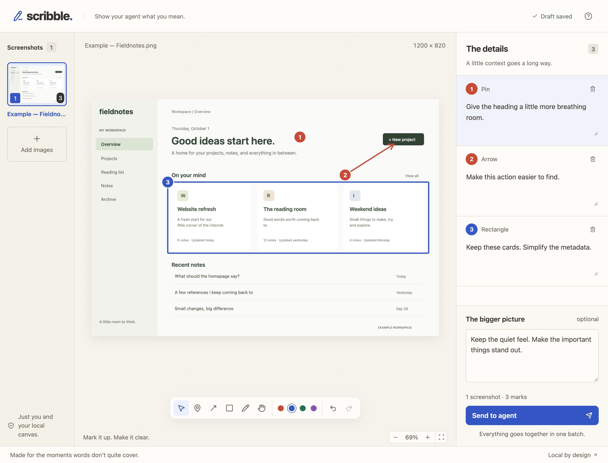

# Scribble

**Show your agent what you mean.**

Scribble is a local browser canvas for visual feedback to Codex and Claude Code. Screenshots, marks, and comments show your agent what to change. Upload images or capture a webpage or simulator screen.

No account, hosted backend, or model API key is required.



## Install the skill

Scribble requires **Node.js 22 or newer**. The skill includes the browser app and server. Screenshot uploads need no separate build or dependency installation. Live capture uses optional tools, described below.

From your project directory, run:

```sh
npx skills add tguidon/scribble
```

The installer offers a choice of agents and installation scope. The repository contains one skill, so `--skill scribble` is optional.

To select Codex and Claude Code directly, run:

```sh
npx skills add tguidon/scribble --agent codex claude-code
```

Add `--global` to install across projects. The [skills CLI documentation](https://github.com/vercel-labs/skills) lists all installation flags.

## Install the plugin

Scribble supports Codex and Claude Code from one shared editor, server, skill, and MCP runtime. Both plugins can send finished feedback back to the chat that opened the canvas.

### Codex (preview)

The Codex plugin requires Node.js 22+ and a desktop host with local MCP support. Ordinary ChatGPT web is not supported by this local package.

Add the GitHub marketplace and install Scribble:

```sh
codex plugin marketplace add tguidon/scribble
codex plugin add scribble@scribble
```

You can also install Scribble from its marketplace in the desktop app's Plugins Directory. Restart the app if its new tools do not appear, then invoke `$scribble start` in your project chat. No npm install or build is required for the installed package.

On hosts that support MCP Apps, choose **Open canvas** in the Scribble card to open the embedded editor. The card stays compact in your chat history. Choose **Finish feedback**, then **Send to this chat**. The host routes the message to the conversation that opened the canvas. **Message accepted** confirms host acceptance; **Feedback read** confirms that the agent retrieved the saved feedback. Neither means the requested changes are complete.

The plugin checks host capabilities. If direct messages are unavailable or rejected, use **Copy for agent**. If the host does not render the editor, use the browser link returned by its tool; the standalone browser keeps its clipboard workflow. Desktop UI and messaging support can vary by host build. The plugin is a preview until the installed desktop workflow is verified.

Each plugin launch creates a separate canvas. **New canvas** starts another round in the same editor. Canvases from separate chats have different IDs, even when they use the same project.

To update the GitHub install:

```sh
codex plugin marketplace upgrade scribble
codex plugin add scribble@scribble
```

Wait for **Draft saved** before updating, then reopen the editor. Installed plugins are cached copies; edits to a source checkout do not update them automatically. See [plugin development and verification](docs/plugin.md).

### Claude Code

Requires **Node.js 22+**, **Claude Code 2.1.304+**, and mods enabled. Add the marketplace and install the plugin from your shell:

```sh
claude plugin marketplace add tguidon/scribble
claude plugin install scribble@scribble
```

Start or restart Claude Code in your project, then run **`/scribble:scribble start`**. Open the browser link Claude returns, annotate your screenshots, choose **Finish feedback**, then **Send to this chat**. The plugin's mod submits your feedback into the originating Claude Code conversation and starts the next turn. No channel flags, separate model API key, or clipboard handoff are needed.

**Feedback queued** means your request is saved and waiting for the chat. **Message accepted** means Claude Code accepted the prompt; **Feedback read** means Claude retrieved the canvas. If Claude is busy, delivery waits until it is idle. Keep the originating session open, or reopen that same session with the plugin enabled. After Esc or Stop, provide input in Claude Code to resume the session, then choose **Retry sending**. **Copy for agent** remains available.

Each new canvas keeps its originating chat binding, including canvases opened with **New canvas**. Clearing or branching a chat creates a different destination; previous feedback stays attached to its original chat. Organization policy, `--safe-mode`, `--bare`, or disabled hooks can prevent mods from running. Claude Code's [mods documentation](https://code.claude.com/docs/en/plugins/mods/overview) describes availability and controls.

To update:

```sh
claude plugin marketplace update scribble
claude plugin update scribble@scribble
```

Restart Claude Code after updating to reload both the mod and MCP runtime. The Claude adapter is implemented; verification in the actual Claude Code host is a manual step. See [local development and host verification](docs/plugin.md).

### Test a fixed release

The `0.0.4` release uses clipboard handoff: finish feedback, copy its file references into your agent, and start another canvas without relaunching the skill. It also includes the split-view layout improvements.

To install the `0.0.4` release:

```sh
npx skills add https://github.com/tguidon/scribble/tree/v0.0.4/skills/scribble
```

This uses the skills CLI’s [direct repository path format](https://github.com/vercel-labs/skills#source-formats). Use a release tag to keep tests on a fixed version; the shorter install command follows the repository’s default branch.

## Use the standalone skill

1. Run **`$scribble start` in Codex** or **`/scribble start` in Claude Code**.
2. Open the session link from your agent.
3. Upload, paste, or drag screenshots onto the canvas. To capture a running app, select **Capture live app**.
4. Add pins, arrows, rectangles, or freehand marks.
5. Add a comment to each mark that needs an explanation.
6. To describe the overall goal, add a message for the session.
7. Select **Finish feedback**, then **Copy for agent**.
8. Paste the copied message into the agent chat where you want the changes made.

The copied message points to a saved brief and the full annotation data. The brief includes your comments, mark positions, capture context, and original image paths. The agent reads those files after you paste the message; Scribble does not send messages automatically. The canvas also supports undo, redo, zoom, and pan.

The bare `$scribble` or `/scribble` command does the same thing. The agent runs the bundled launcher, opens the editor, and ends its turn. No project build or capture-tool installation is needed to open it.

You can also add:

- `start --new` to open a fresh draft while preserving earlier feedback.
- `status` to check the current session and server.
- `stop` to shut down Scribble without deleting saved feedback.

For example, use `$scribble stop` in Codex or `/scribble stop` in Claude Code. A normal start resumes a draft or opens a new session after the previous one was finished.

After copying, select **New canvas** to collect another round without calling the skill again. Earlier feedback and image paths remain available. If clipboard access is blocked, expand **View handoff message** and copy the text manually.

The receiving agent needs access to the saved files on this device. Pasting local paths into a cloud-only chat does not upload the files.

## Capture a running app

Direct webpage capture works best with local apps. For hosted sites, existing logins, or human-verification checks, use **Share browser tab**.

Scribble saves each capture as a still image in the same annotation editor. Your app keeps running. Later captures do not change earlier images or marks.

### Set up capture tools

Selecting **Open webpage** or **Connect simulator** installs missing tools automatically. The first download can take a few minutes.

To install the tools ahead of time, run the relevant command from this repository:

```sh
node bin/scribble.mjs setup web
node bin/scribble.mjs setup simulator
```

For an installed skill, replace `bin/scribble.mjs` with the absolute path to its `scripts/scribble.mjs` file. If you use custom storage, pass the same `--dir PATH` to setup and startup.

- **Webpage:** Setup installs Playwright and downloads Chromium. The browser runs in the background and streams its viewport into Scribble.
- **Simulator:** Setup installs serve-sim. Capture requires an Apple Silicon Mac, Xcode, and a booted simulator. Scribble also accepts serve-sim on `PATH`.

The optional packages live in `.scribble/capture-runtime/`. Chromium uses Playwright’s browser cache. Setup requires internet access. Scribble stores captured images and feedback locally.

### Capture a webpage

1. For a local app, start its development server.
2. Select **Capture live app**, then **Webpage**.
3. Enter a URL, or select an app under **Running on this Mac**.
4. Select **Open webpage**.
5. Click, scroll, or type in the embedded live screen.
6. Select **Capture & annotate**.

Scribble streams a browser viewport directly into its canvas. This also works with pages that block iframe embedding. Use the back and reload controls above the screen to navigate. Each capture records the URL, page title, viewport dimensions, scroll position, and capture time.

Use **Desktop**, **Laptop**, **Tablet**, or **Phone** above the live screen to check a different viewport. The presets use 1920 × 1080, 1280 × 900, 768 × 1024, and 390 × 844 pixels. Switching sizes keeps the current page open, including form input. For another size, expand **Webpage settings → Viewport size**, enter dimensions, and select **Apply size**. These controls resize the webpage viewport; shared browser tabs use the original tab's size.

Select **Capture full page & annotate** to save the full scrollable webpage as one image. It uses the currently selected viewport without changing the responsive layout, visits lower sections to load lazy content, and restores your scroll position afterward. The capture records the viewport separately from the full image dimensions, with `fullPage: true` and an image origin of `(0, 0)`. Preparation is limited to 10 seconds and 100 steps; pages that keep growing or exceed the 40-megapixel / 20 MB image limits show an error. Use **Capture & annotate** for visible sections instead. Full-page capture applies to direct webpages; shared tabs and simulators capture their visible screen. Independently scrolling panels and virtualized lists may contain content outside the full-page image.

The capture browser has a separate temporary profile. It does not share your normal browser’s logins. Public and local HTTP or HTTPS URLs are supported. You can enter `example.com` or `localhost:3000` without a scheme. File URLs and URLs with embedded credentials are rejected.

Scribble checks local development-server ports and lists those that return HTML. Select **Refresh sources** after starting another app. If automatic discovery is unavailable, enter the URL directly.

### Share a browser tab

1. Open the Scribble session link in Chrome or Edge.
2. Open the website in another tab. Sign in or complete verification there.
3. In Scribble, choose **Capture live app → Webpage → Share browser tab**.
4. Select **Share browser tab**, then choose the website’s tab in the browser picker.
5. Navigate in the original tab. Its live picture appears in Scribble.
6. Select **Capture & annotate** to save a still image.

Sharing is view-only inside Scribble. It requires no browser automation tools or extension. The live stream stays in your browser; captured frames are saved to the local Scribble server. Audio is not requested.

Sharing stays active while you annotate. Use **Return to shared tab** for another capture, or **Stop sharing** to end it. Submitting feedback or closing the tab ends sharing. After a reload, choose a tab again. Browsers without screen-sharing support show **Copy session link** so you can continue in Chrome or Edge.

If you select a window or screen instead of a tab, Scribble labels it accordingly. Shared captures record the surface type, dimensions, and capture time. The browser does not provide the website URL or scroll position through this flow.

### Capture a simulator

1. Launch your app in Simulator.
2. Select **Capture live app**, then **Simulator**.
3. Choose a booted device and select **Connect simulator**.
4. Tap or drag directly on the simulator screen inside Scribble.
5. Select **Capture & annotate**.

Scribble reuses or starts serve-sim for the selected device and embeds only its screen. The Home control returns to the simulator home screen. Each capture records the device, orientation, capture time, and app identifier when available.

Click the embedded screen before typing, or expand **Type or paste text**. Press Escape to return keyboard control to Scribble. Simulator text input supports US keyboard characters; use the simulator’s on-screen keyboard for other text.

Direct webpage and simulator views pause when the Scribble tab is hidden and stop when you return to annotations. **Reconnect** restores the selected live view. The stream and input requests use the same session authentication as saved feedback.

### Simulator input with Xcode 27

Device Hub can disable the legacy input path used by serve-sim. Scribble detects this state and keeps capture available while disabling touch and keyboard controls. The repair closes running simulator apps, so the agent must ask before running it. After repair and relaunching your app, select **Reconnect**.

### Continue a review

Select **Resume live capture** to return to a source and capture another screen. Add marks and comments in the editor, then select **Finish feedback** and **Copy for agent**. Paste the handoff into your agent chat. The feedback bundle and brief include each image’s capture context.

**Close webpage** closes the temporary browser and clears its login state. **Disconnect simulator** leaves the simulator and shared serve-sim preview running. Source connections end when Scribble stops; saved images and feedback remain available.

## Sessions and saved drafts

The agent runs the skill only after an explicit request. The launcher sends an authenticated request to the local server. If the server responds and matches the installed version and server protocol, the launcher reuses it. If either differs, the launcher requests an authenticated shutdown and starts the installed version on the same port. If no server process is running, it starts one in the background. If a recorded process is still alive but does not respond, the launcher asks you to retry or stop that process before restarting.

The latest unfinished draft resumes automatically. Finished feedback stays on disk. Use **Copy for agent** on its receipt to copy the exact session paths, then paste into your chosen chat. **New canvas** starts another round on the same server. You can return to an older receipt with its original URL or `start --session ID`.

Scribble saves drafts and screenshots in `.scribble/` in your project. On startup, it adds the storage directory to Git’s local `info/exclude` file. This keeps screenshots, feedback, and session tokens out of new commits without changing your shared `.gitignore`. Custom storage directories inside a Git repository receive the same protection. If storage files are already tracked, startup stops and asks you to remove them from Git’s index. A browser backup stores unsaved edits to marks and messages. Saved work remains available after the agent or server stops.

Each project has a separate server and storage directory. A startup lock coordinates launchers. A lifetime lock gives one server ownership of the storage directory. Slow uploads do not block health checks or other sessions. The server accepts connections only at `127.0.0.1`. Screenshots and feedback require a session token.

### Server and browser versions

If capture reports that the server is too old, run the Scribble skill again and reload the browser tab. The launcher upgrades versioned servers automatically. Pre-versioning servers require your agent to inspect and stop the reported process first. Saved drafts remain available. A version check now identifies this condition before capture, instead of showing a generic “Not found” error.

### Recover a draft

- If a save fails, select **Retry save**. Keep the tab open until **Draft saved** appears.
- To resume a saved draft, run the skill again.
- If a save response is lost, **Retry save** safely repeats that save before saving newer edits. Reloading also recovers the newer browser draft when Scribble can identify the saved request.
- If another tab saves a conflicting draft, reload the page. Select **Download unsaved draft** to keep your local edits, then **Use saved draft** to continue with the server version. Scribble preserves the backup until you make this choice.

Undo and redo apply to marks and text. They do not apply to screenshot uploads or removal. Screenshot removal excludes the image from the draft but preserves the original file on disk.

## Limits

| Item | Limit |
| --- | --- |
| Screenshots | 30 per session |
| Image formats | PNG, JPEG, WebP |
| Image size | 20 MB and 40 megapixels per image |
| Marks | 500 per image |
| Freehand points | 5,000 per drawing |
| Comment length | 10,000 characters |
| Overall message | 20,000 characters |
| Combined draft | 4 MB of UTF-8 JSON for marks, text, and screenshot metadata; original image files are separate |

If an edit would exceed the combined limit, Scribble keeps the previous valid draft and explains how to reduce it.

## Development

From this repository, run:

```sh
npm install
npm run dev
```

Open the full session URL from the terminal. Keep the token after `#` in the URL.

| Command | Purpose |
| --- | --- |
| `npm run build` | Check TypeScript and build the browser app, plugin UI, and plugin runtime |
| `npm run build:plugin` | Rebuild the embedded editor, bundled MCP SDK, and both harness manifests |
| `npm start` | Run the built app and open the browser |
| `npm test` | Run server, storage, and launcher tests |
| `npm run test:e2e` | Run browser tests with Playwright's dedicated Chromium browsers |

Before running tests, install Playwright's matching browsers:

```sh
npx playwright install chromium
```

Both test commands need permission to start browser processes and bind local server ports. They stop before starting workers if the environment blocks these requirements. The default tests do not launch your installed Chrome application. See [test setup and large-draft recovery](docs/testing.md) for browser setup, a Chrome compatibility command, and the resolved draft timeout.

The complete skill is in `skills/scribble/`. The core server uses only Node built-ins. Optional capture adapters load Playwright or call serve-sim. Vite writes the browser build to `skills/scribble/app/`. The skills installer copies these files without a build step.

After UI changes, run `npm run build`. Commit `skills/scribble/app/` and `plugin/dist/` with the source changes. Installed packages use these bundles without a build step.

### Publish a version

Keep `package.json`, the root entries in `package-lock.json`, `plugin.json`, and `skills/scribble/version.json` on the same version. Build to refresh the generated Codex and Claude Code manifests. The installed server reads the bundled version file without needing the development package. Plugin updates are distributed from `main` after merge; the existing `v0.0.4` tag remains the standalone clipboard release.

Build and test, commit the changes, then tag that commit as `vVERSION` and publish its GitHub release. Keep published tags fixed so a tagged installation remains reproducible.

## Command reference

In this repository, use `node bin/scribble.mjs` as the command prefix.

For an installed skill, use `node /absolute/path/to/skills/scribble/scripts/scribble.mjs` as the command prefix.

| Command | Behavior |
| --- | --- |
| `start --detach --no-open` | Start or reuse the server and return the session URL as JSON |
| `start --new` | Create a separate draft while preserving earlier feedback |
| `start --session ID` | Open a saved draft or submission |
| `feedback --session ID` | Read a saved submission as a feedback brief |
| `feedback --session ID --full` | Read the full JSON, including every drawing point |
| `status` | Show the latest session and recorded server version and process |
| `stop` | Shut down the authenticated server and preserve saved feedback |
| `setup web` | Install Playwright and Chromium for webpage capture |
| `setup simulator` | Install serve-sim for simulator capture |
| `--version` | Print the installed version |

Common flags are `--dir PATH`, `--port NUMBER`, and `--title TEXT`. The default port is 0, which selects an available port. Background server logs are in `.scribble/server.log`.

If separate agents need independent sessions, use a separate `--dir` for each agent.

### Stop or update

Before stopping or updating, wait for **Draft saved** in open browser tabs.

```sh
node bin/scribble.mjs stop
```

For an installed skill, use its absolute script path as described above. Pass the same `--dir` if you use custom storage. Repeating `stop` is safe. Saved drafts and submissions remain on disk.

To update the skill, run `npx skills add tguidon/scribble` again. The next launch compares versions and restarts the server when needed. The restart keeps the same port, so browser backups remain on the same origin. Reload open tabs after the restart to load the updated app.

Servers from before versioning was added need a one-time manual stop. The launcher reports the PID; inspect that process before stopping it with your process manager. The launcher does not stop a process it cannot authenticate.

Agent sandboxes can require permission to open a local port or start a background process.

## Feedback format

Each session contains `session.json` and original screenshots in `images/`. Finishing feedback creates an immutable `feedback.json` bundle and a readable `feedback.md` brief before the copy button becomes available.

The `feedback` command can also read a saved submission and regenerate its brief, including for older sessions. It returns the brief text, its path, and the full JSON path. The brief puts the overall request first, followed by each screenshot and its numbered marks. It includes:

- Original image paths, dimensions, and exact comments.
- Mark locations and bounds in pixels and percentages of the image size.
- Arrow starts, tips, and directions.
- Freehand bounds and an approximate outline of at most 16 points, with its maximum point deviation in pixels. Full drawing points stay in the JSON.
- The smallest rectangle containing each pin or arrow tip, including its boundary.

Region labels describe the mark's bounds center within a 3 × 3 image grid. Spatial relationships describe geometry; they do not infer a requested change. The agent still inspects the original images. No images are rendered or sent to an external service to create the brief.

Use `--full` with `feedback` to return the original JSON instead of the brief.

The feedback bundle contains:

- The session ID, title, submission time, and overall message.
- Each screenshot's path, name, dimensions, and MIME type.
- Each mark's type, color, points, comment, and number within its screenshot.

Coordinates use **original image pixels from the top-left corner**. Zoom and pan do not change these coordinates. Pins have one point. Arrows and rectangles have endpoints. Freehand marks have ordered points.

The handoff copies a short message with absolute file paths. It contains no image bytes or browser access token.

The example screenshot shows a fictional workspace. Scribble creates it locally without external images or customer data.
